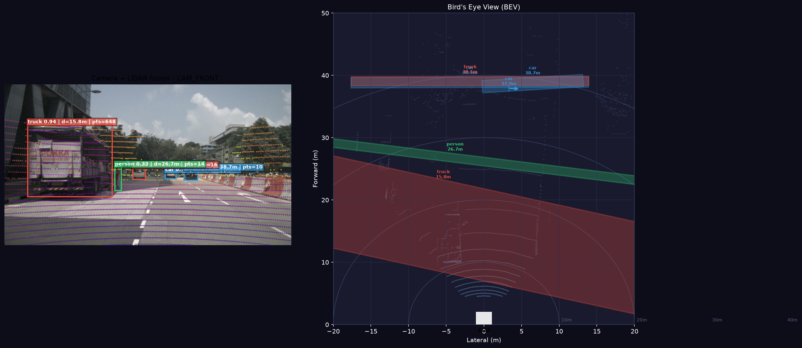
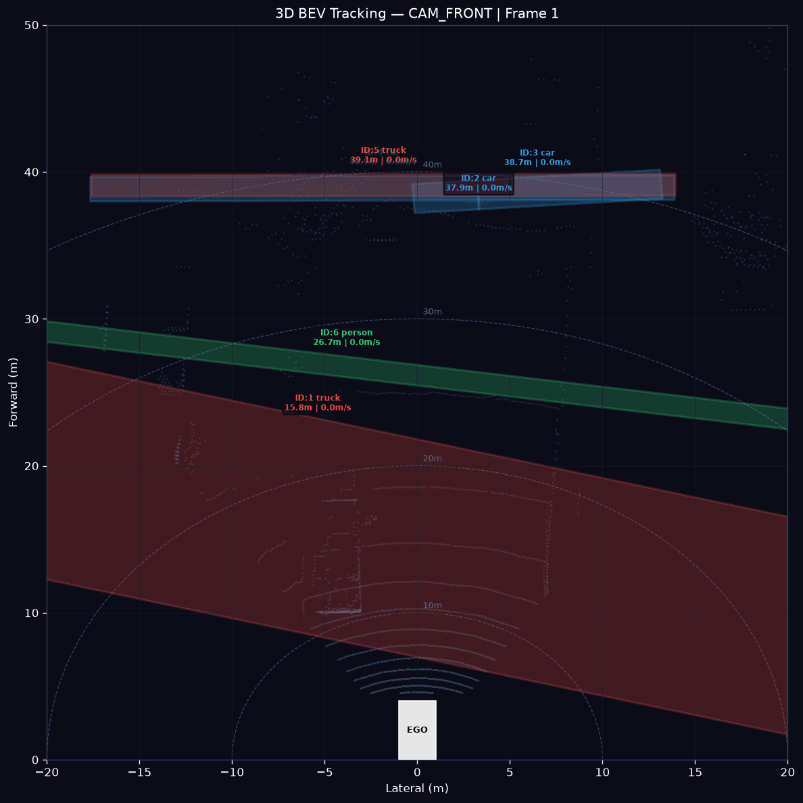
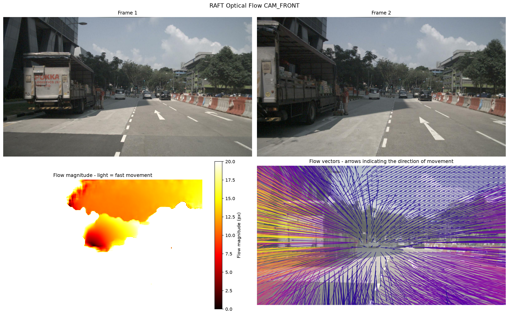

# AV Perception Pipeline

End-to-end multi-sensor perception system for autonomous driving, 
built on the nuScenes dataset.

**Stack:** Python · PyTorch · YOLOv8 · nuScenes devkit · Open3D · RAFT

---

## Components

| Component | Status | Details |
|-----------|--------|---------|
| 6-camera data loader | ✅ | All sensors synchronized, ego pose aligned |
| LiDAR → camera projection | ✅ | Depth colormap, Z-filter, intrinsic/extrinsic transform |
| 2D object detection | ✅ | YOLOv8m, conf=0.3, AV-relevant classes |
| 2D multi-object tracking | ✅ | ByteTrack, trajectory visualization, GIF output |
| Monocular depth estimation | ✅ | Depth Anything v2, AbsRel metric vs LiDAR GT |
| Optical flow | ✅ | RAFT, ego motion visualization, flow magnitude map |
| Camera–LiDAR fusion | ✅ | Projection-based, PCA 3D box fitting, BEV output |
| 3D multi-object tracking | ✅ | Kalman filter in BEV space, velocity estimation |
| Evaluation (mAP / NDS) | 🔲 | Planned: nuScenes official metrics |

**Dataset:** nuScenes mini (v1.0) — 10 scenes, 6 cameras, LiDAR, radar

---

## Demo

### Camera–LiDAR Fusion + BEV


### 3D Multi-Object Tracking (BEV)


### RAFT Optical Flow


### 2D Tracking


---

## Architecture
Camera frames (6×) ──┐
├──▶ 2D Detection (YOLOv8) ──▶ 2D Tracking (ByteTrack)
LiDAR point cloud ───┤
├──▶ Camera–LiDAR Fusion ──▶ 3D Boxes (PCA)
│ │
└──▶ Depth Estimation (DAv2) ▼
3D Tracking (Kalman/BEV)
Consecutive frames ───────▶ Optical Flow (RAFT)

---

## Setup

```bash
python -m venv venv
venv\Scripts\activate # Windows
pip install -r requirements.txt
```

## Run

```bash
# Data loading & visualization
python perception/data/nuscenes_loader.py

# LiDAR projection
python perception/data/lidar_projection.py

# 2D Detection
python perception/detection/detector.py

# 2D Tracking (ByteTrack)
python perception/tracking/tracker.py

# Depth Estimation (Depth Anything v2)
python perception/depth/depth_estimator.py

# Optical Flow (RAFT)
python perception/depth/optical_flow.py

# Camera-LiDAR Fusion + BEV
python perception/fusion/fusion.py

# 3D Tracking in BEV
python perception/tracking/tracker_3d.py
```

## Project Structure

perception/
├── data/ # nuScenes loader, LiDAR projection
├── detection/ # YOLOv8 2D detection
├── depth/ # Depth Anything v2, RAFT optical flow
├── fusion/ # Camera-LiDAR fusion, PCA 3D box fitting
└── tracking/ # ByteTrack 2D, Kalman 3D tracking
outputs/ # Generated images, GIFs


## Key Technical Decisions

- **Projection-based fusion** over learned methods (PointPillars, BEVFusion):
  simpler to understand and debug, no additional training required
- **PCA for 3D orientation**: fast, no ML required, explainable
- **RAFT for optical flow**: iterative refinement outperforms single-pass networks
- **Kalman filter in BEV**: optimal linear state estimation,
  constant velocity model suitable for short sequences

## Limitations & Next Steps

- PCA orientation estimation degrades for objects viewed head-on
  (few lateral LiDAR points)
- Replace projection fusion with proper BEV transformation (BEVFusion-style)
- Add official nuScenes evaluation: mAP, NDS, AMOTA
- Extend to full trainval split for quantitative comparison