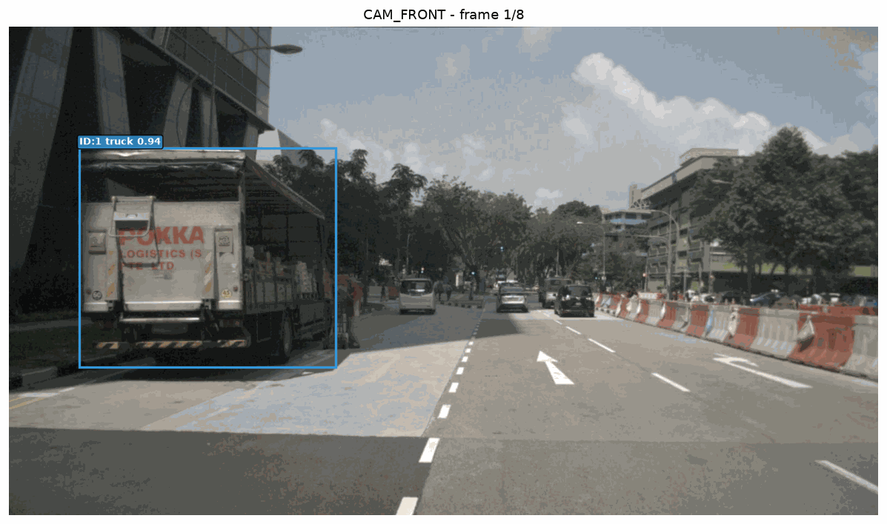
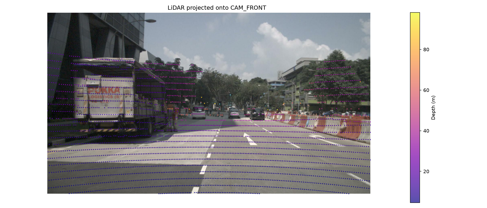

# AV Perception Pipeline

Multi-sensor perception system for autonomous driving built on nuScenes.

**Components (in progress):**
- ✅ Data loading & 6-camera visualization
- ✅ LiDAR-to-camera projection with depth colormap  
- ✅ YOLOv8 object detection on all 6 cameras
- ✅ Multi-object tracking with ByteTrack + trajectory visualization
- 🔲 Monocular depth estimation (Depth Anything v2)
- 🔲 Camera-LiDAR fusion → 3D bounding boxes
- 🔲 3D multi-object tracking in BEV space

**Dataset:** nuScenes mini (v1.0)

---

## Demo

### Multi-object tracking


### LiDAR projected onto camera


---

## Results
| Component | Status | Notes |
|-----------|--------|-------|
| 6-camera loader | ✅ | All sensors synchronized |
| LiDAR projection | ✅ | Depth colormap, points filtered |
| 2D Detection | ✅ | YOLOv8m, conf=0.3 |
| MOT tracking | ✅ | ByteTrack, 4 unique tracks / 8 frames |
| Depth estimation | 🔲 | Planned: Depth Anything v2 |
| Fusion | 🔲 | Planned: projection-based |
| 3D tracking | 🔲 | Planned: Kalman in BEV |

---

## Setup
```bash
python -m venv venv
venv\Scripts\activate  # Windows
pip install -r requirements.txt
```

## Run
```bash
# Data visualization
python perception/data/nuscenes_loader.py

# LiDAR projection
python perception/data/lidar_projection.py

# Detection
python perception/detection/detector.py

# Tracking
python perception/tracking/tracker.py
```

## Project Structure
```
perception/
├── data/         # nuScenes loading, LiDAR projection
├── detection/    # YOLOv8 detection
├── tracking/     # ByteTrack MOT
```