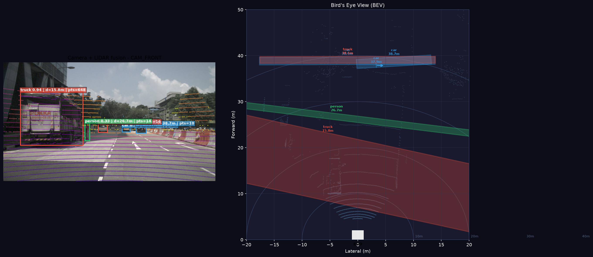
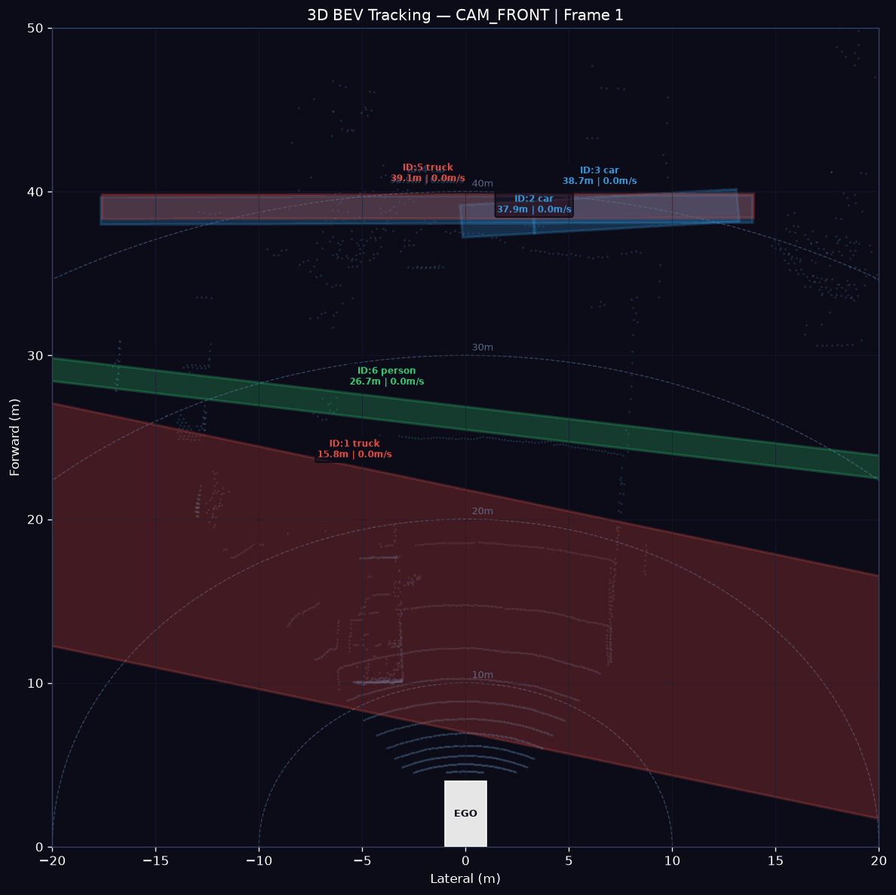
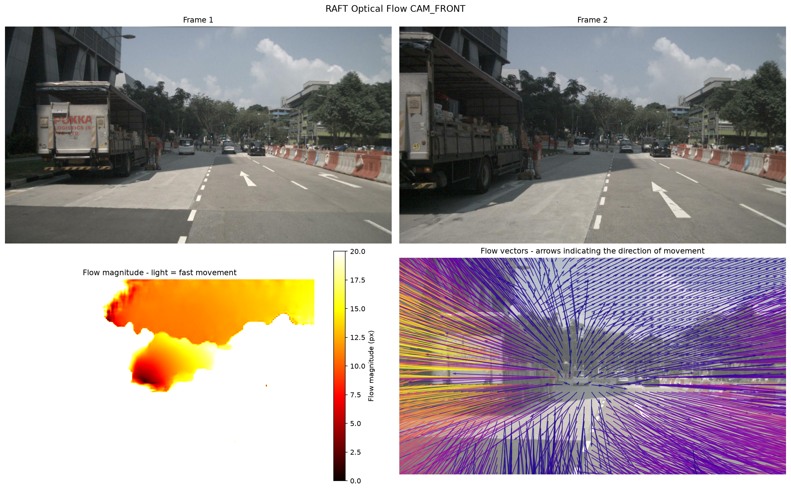
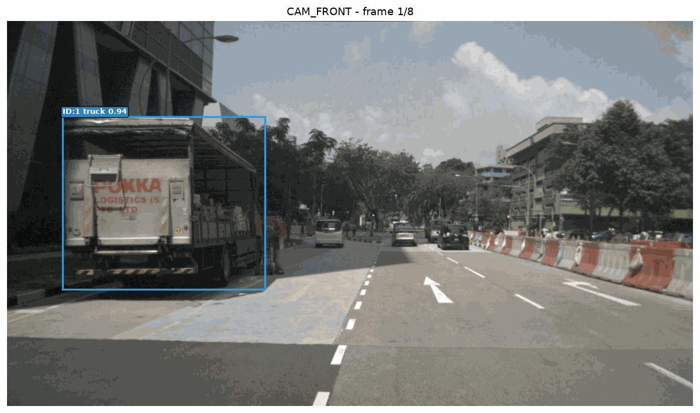

# AV Perception Pipeline

End-to-end multi-sensor perception system for autonomous driving, 
built on the nuScenes dataset.

**Stack:** Python · PyTorch · YOLOv8 · nuScenes devkit · Open3D · RAFT

---

## Components

| Component | Status | Details |
|-----------|--------|---------|
| 6-camera data loader | ✅ | All sensors synchronized, ego pose aligned |
| LiDAR → camera projection | ✅ | Depth colormap, Z-filter, intrinsic/extrinsic transform |
| 2D object detection | ✅ | YOLOv8m, conf=0.3, AV-relevant classes |
| 2D multi-object tracking | ✅ | ByteTrack, trajectory visualization, GIF output |
| Monocular depth estimation | ✅ | Depth Anything v2, AbsRel metric vs LiDAR GT |
| Optical flow | ✅ | RAFT, ego motion visualization, flow magnitude map |
| Camera–LiDAR fusion | ✅ | Projection-based, PCA 3D box fitting, BEV output |
| 3D multi-object tracking | ✅ | Kalman filter in BEV space, velocity estimation |
| Evaluation (mAP / NDS) | 🔲 | Planned: nuScenes official metrics |

**Dataset:** nuScenes mini (v1.0) — 10 scenes, 6 cameras, LiDAR, radar

---

## Demo

### Camera-LiDAR Fusion + BEV


### 3D Multi-Object Tracking (BEV)


### RAFT Optical Flow


### 2D Tracking


---

## Architecture
Camera frames (6×) ──┐
├──▶ 2D Detection (YOLOv8) ──▶ 2D Tracking (ByteTrack)
LiDAR point cloud ───┤
├──▶ Camera–LiDAR Fusion ──▶ 3D Boxes (PCA)
│ │
└──▶ Depth Estimation (DAv2) ▼
3D Tracking (Kalman/BEV)
Consecutive frames ───────▶ Optical Flow (RAFT)

---

## Setup

```bash
python -m venv venv
venv\Scripts\activate.bat
pip install -r requirements.txt
```

## Run

```bash
# Data loading & visualization
python perception/data/nuscenes_loader.py

# LiDAR projection
python perception/data/lidar_projection.py

# 2D Detection
python perception/detection/detector.py

# 2D Tracking (ByteTrack)
python perception/tracking/tracker.py

# Depth Estimation (Depth Anything v2)
python perception/depth/depth_estimator.py

# Optical Flow (RAFT)
python perception/depth/optical_flow.py

# Camera-LiDAR Fusion + BEV
python perception/fusion/fusion.py

# 3D Tracking in BEV
python perception/tracking/tracker_3d.py
```

## Project Structure

perception/
├── data/ # nuScenes loader, LiDAR projection
├── detection/ # YOLOv8 2D detection
├── depth/ # Depth Anything v2, RAFT optical flow
├── fusion/ # Camera-LiDAR fusion, PCA 3D box fitting
└── tracking/ # ByteTrack 2D, Kalman 3D tracking
outputs/ # Generated images, GIFs


## Key Technical Decisions

- **Projection-based fusion** over learned methods (PointPillars, BEVFusion):
  simpler to understand and debug, no additional training required
- **PCA for 3D orientation**: fast, no ML required, explainable
- **RAFT for optical flow**: iterative refinement outperforms single-pass networks
- **Kalman filter in BEV**: optimal linear state estimation,
  constant velocity model suitable for short sequences

## Limitations & Next Steps

- PCA orientation estimation degrades for objects viewed head-on
  (few lateral LiDAR points)
- Replace projection fusion with proper BEV transformation (BEVFusion-style)
- Add official nuScenes evaluation: mAP, NDS, AMOTA
- Extend to full trainval split for quantitative comparison

## Evaluation (nuScenes mini_val, camera-only baseline)

Detector: YOLOv8m (COCO classes mapped to nuScenes). 2D boxes are lifted to 3D
using a depth estimate; box size is a per-class constant and orientation is
copied from the ego pose, so this is a deliberately simple baseline.

| Version | Depth source | mAP | NDS |
|---------|--------------|-----|-----|
| v1 | Box-height heuristic | 0.0797 | 0.1095 |
| v2 | Depth Anything V2 (metric) | 0.0268 | 0.0461 |
| v3 | LiDAR points in box (median), heuristic fallback | 0.1128 | 0.1030 |
| v3b | v3 + larger patch and lower point threshold for small boxes | 0.1181 | 0.1051 |

### Why v2 is worse than v1
I measured both depth sources against LiDAR (`eval/depth_diagnostics.py`,
164 boxes):

| | median(pred/LiDAR) | AbsRel | within 25% |
|---|---|---|---|
| Height heuristic | 1.09 | 0.16 | 81% |
| Depth Anything V2 metric | 1.48 | 0.58 | 21% |

Depth Anything overestimates distance by ~50% on nuScenes, consistent with a
domain gap (the model is trained on synthetic Virtual KITTI). nuScenes matches
detections by center distance with thresholds up to 4 m, so errors of several
metres remove almost all true positives.

Limitation: objects beyond ~30 m had too few LiDAR points to be verified.

### v3: LiDAR depth
About half of the boxes (51%) get depth from LiDAR, the rest fall back to the heuristic.

| Class | v1 AP | v3 AP |
|---|---|---|
| car | 0.223 | 0.220 |
| truck | 0.151 | 0.275 |
| bus | 0.142 | 0.127 |
| pedestrian | 0.230 | 0.301 |
| motorcycle | 0.051 | 0.130 |
| bicycle | 0.001 | 0.075 |

LiDAR depth helps trucks, pedestrians and two-wheelers, while cars are unchanged.

### Why so many fallbacks?
The share of boxes without enough LiDAR points depends strongly on box size:

| Box height | Boxes | Fallback |
|---|---|---|
| < 30 px | 237 | 97% |
| 30-60 px | 1080 | 87% |
| 60-120 px | 1573 | 51% |
| > 120 px | 1343 | 6% |

My hypothesis is that LiDAR rings are sparse in the image at long range, so the
central patch of a small box rarely contains enough points. v3b tests this.

### Caveats
- NDS did not improve with mAP: velocity error crossed the cap of 1 because I always predict zero velocity.
- Only two validation scenes, so differences of about 0.01 mAP are within noise.
- The LiDAR percentile was chosen on the same scenes used for evaluation.